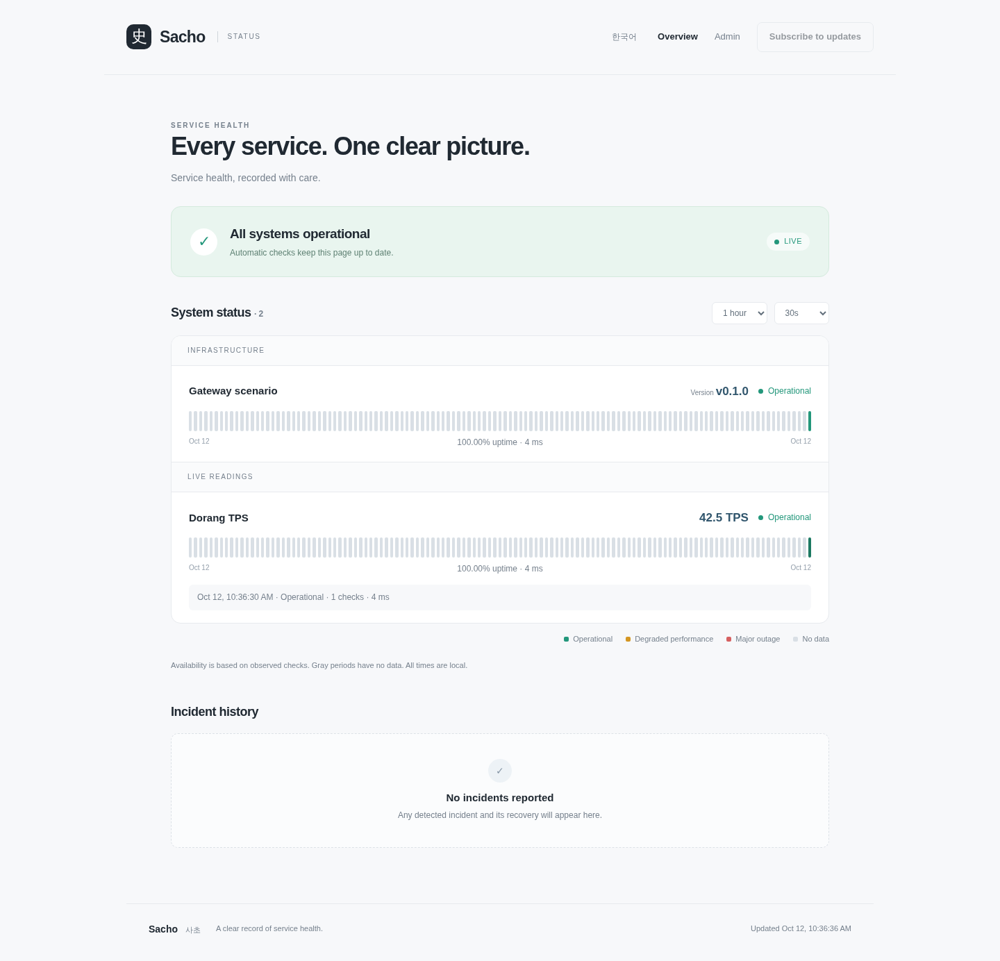
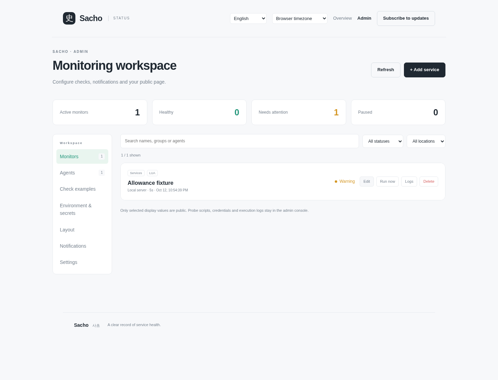

# Sacho · 사초

A single-binary status page and continuous health monitor. *Sacho* is the original
record from which an annal is written: a clear account of what happened to your
services.

Sacho focuses on monitoring, status/history and reliable notifications. Incident
management, acknowledgement, ownership, on-call and remediation belong to external
systems connected by webhooks; they are outside the current product scope.

[한국어](README.ko.md) · [Lua scenarios](docs/LUA.md) · [Deployment](docs/DEPLOYMENT.md)





Built-in Prometheus instant queries, DNS record checks, TCP connection timing and
per-monitor authenticated Push reports complement HTTP and trusted Shell/Python/Lua
checks. Admin-managed encrypted inputs support hot rotation. Checks can use cron in
an explicit IANA timezone and opt-in controller actions with streaks, delays, retries,
cooldowns and post-action grace. Language and display timezone use persistent dropdowns.
See [the embedded monitoring guide](docs/MONITORING.md) for exact protocol and action semantics.

## Run

Download `sacho-<target>` from [Releases](https://github.com/ziozzang/sacho/releases),
rename it to `sacho`, and make it executable. Or build from source:

```sh
cargo build --locked --release
./target/release/sacho init --config sacho.toml
./target/release/sacho doctor --config sacho.toml
./target/release/sacho serve --config sacho.toml
```

Open `http://127.0.0.1:8080/` and `/admin`. The default is a private, loopback-only
console without authentication. For a public page, configure a trusted auth proxy
and administrator email addresses; see [deployment](docs/DEPLOYMENT.md).

The executable embeds the frontend, CodeMirror Lua editor, Lua 5.4 and SQLite.
No Node.js, CDN, external database or Lua installation is needed to run it.
Python checks optionally require `python3`; shell checks require `/bin/sh`.
Configuration and the persistent SQLite database are separate runtime files.

Sacho v0.1.4 adds verified SQLite/PostgreSQL snapshot transfer and
PostgreSQL lease/fencing primitives, plus outbound remote monitoring workers.
The serving backend remains SQLite; one controller manages multiple remote network
locations. Multi-controller HA is deferred. See [remote workers](docs/REMOTE-WORKERS.md). See [persistence](docs/DATABASE.md)
(`sacho help storage`) and the [enterprise implementation inventory](docs/architecture/ENTERPRISE.md).

For threshold rules, charts, agent health, setup validation and notification
controls, see [monitoring setup](docs/MONITORING.md), also embedded as
`sacho help monitoring`.

## Capabilities

- Public system status, per-service availability, incident history, responsive
  English/Korean interface and email subscription confirmation/unsubscription.
- HTTP/API, shell, Python and embedded Lua checks. Lua scenarios can perform
  several HTTP requests and assert response content without an external script
  runtime. Syntax highlighting, API completion and draft execution live in admin.
- Configurable intervals/timeouts, expected HTTP/exit codes, text matching, JSON
  numeric comparisons, latency degradation and consecutive failure/recovery gates.
- Display the latest query result independently from health: version strings, TPS,
  subscription remaining percentages or another scalar. Public display is opt-in;
  scripts, raw output, credentials and condition configuration remain private.
- Published values stay visible with a timestamp when later queries fail; optional
  public explanations and warning severity distinguish collector issues.
- Docker container monitoring through native Lua HTTP over a Unix socket, including
  running/stopped and HEALTHCHECK states: `sacho example docker`.
- Durable observations and logs; 5s, 10s, 30s, 1m, 5m, 30m, 1h and daily aggregation, from a
  one-hour detail view to 90 days. Empty periods stay gray. Uptime is the fraction
  of **observed checks** that passed, not a claim about unobserved wall-clock time.
- Time gaps are limited by the selected range and configured check intervals;
  changing the range automatically picks a suitable resolution. Dense series
  retain their query resolution and combine bars for a bounded visual width.
- Administrator layout editor: named sections, drag/drop ordering and cross-section
  moves, keyboard-accessible move controls, preview and persistent publication.
- SMTP and webhooks on incident start and recovery. State, incidents and delivery
  jobs commit together; repeated failures do not create repeated incident jobs.
- Signed GitHub/custom HTTPS updates with Ed25519 verification, SHA-256/size/target
  checks, downgrade prevention, atomic binary replacement and supervised restart.
  Failed readiness or exit during a 30-second probation restores the prior binary.

## Checks and latest values

Add a service in `/admin`, select its check type, enter the URL or script and click
**Test draft**. This executes once without saving observations or sending alerts.
Save to schedule it. **Run now** schedules another observation; **Logs** shows its
execution time, result, stdout/stderr and condition failures.

```lua
local live = sacho.http("http://127.0.0.1:4000/health/liveliness")
assert(live.status == 200, "Dorang liveness failed")
local ready = sacho.http("http://127.0.0.1:4000/health/readiness")
assert(ready.status == 200, "Dorang readiness failed")
return sacho.json_encode({value = "live + ready"})
```

Enable **Display latest value publicly** and set the display JSON pointer to
`/value`. A version result such as `{"version":"v1.2.3"}` uses `/version`. A TPS
result uses `/tps` and an optional ` TPS` unit. Leave **Numeric threshold** empty
for display-only values. If a numeric condition is desired, specify its own JSON
pointer and comparison, independently of the display pointer.

The JSON API accepts the same fields as [`CheckSpec`](src/db.rs). Mutating admin
requests require `X-Sacho-Request: 1` and, when present, an Origin equal to
`public_url`. Examples and a repeatable importer are in [`examples`](examples)
and [`tools/import_checks.py`](tools/import_checks.py).

### External scenarios

Sacho contains no provider-specific usage clients or credential readers. Keep that
logic in your own external Lua/Python/shell scenarios. A Lua scenario can invoke
an external program with `sacho.exec({"python3", "/opt/checks/health.py"})`, inspect
its exit code, and decode its JSON stdout. Commands inherit only the probe
allowlisted environment, have bounded captured output, and share the scenario
process group and timeout. See [external-command.lua](examples/lua/external-command.lua).

## Notifications

Configure `[smtp]` in `sacho.toml` and keep its password in the named environment
variable. Without SMTP, email subscriptions are disabled visibly. Confirmation
expires after 24 hours, and GET links show a confirmation form so email scanners
cannot silently subscribe or unsubscribe a user. Register/remove webhook endpoints
and inspect subscriber/delivery lists in **Notifications**.

A webhook contains `event` (`incident.started` or `incident.resolved`),
`incident_id`, `item_id`, `name`, `status`, `at` and `delivery_id`. The same stable
`delivery_id` is sent as `Idempotency-Key` on retries. Delivery is at least once:
receivers should deduplicate that key. SMTP cannot guarantee exactly-once delivery
if the connection is lost after acceptance. Failed jobs retry up to eight attempts
with exponential delay; the administrator sees pending, successful and failed jobs.

These event names describe automatically detected outage/recovery intervals and
are retained for compatibility. `incident_id` correlates start and recovery; it is
not an incident-management workflow. A receiver can use these events to manage
incidents in its own system.

## Updating

```sh
sacho update --check                # metadata only
sacho update --config sacho.toml    # install while the server is stopped
```

For automatic update/restart, enable `[updates].enabled`. `serve` keeps a stable
supervisor and runs the HTTP/monitoring worker as a child of the same executable.
A readiness handshake verifies startup; probation requires it to remain alive for
30 seconds. Updates check on startup and at the configured interval. The binary
must reside in a directory writable by the service user. SIGTERM interrupts even
a stalled update request. An instance lock prevents competing servers/CLI updates
for the same database. A manual install keeps a rollback file and requires restart.

Only releases signed by the embedded public key or an explicitly configured
operator key can install. Release signing seeds live outside the repository and
in GitHub's `SACHO_RELEASE_SIGNING_KEY` secret; they are never needed by the server.
Custom origins may set `manifest_url` and `ca_file`. Existing database schemas
newer than the running binary are rejected; backup the database before introducing
future schema migrations that would prevent an older binary from opening it.

## Development and verification

Rust 1.96+ and a C compiler build the vendored Lua/SQLite libraries. The bundled
editor is committed; Node.js is needed only when changing that editor:

```sh
cargo fmt --all -- --check
cargo clippy --locked --all-targets -- -D warnings
cargo test --locked --all-targets
python3 tests/smoke.py
python3 tests/cli.py
python3 tests/data_sources.py
python3 -m pip install -r tests/requirements.txt
python3 -m playwright install chromium
python3 tests/browser.py
python3 tests/refresh.py
python3 tests/restart.py
# Optional isolated integration against a Hangang executable:
python3 tests/hangang_proxy.py
# Optional owned PostgreSQL container (psql + local postgres:17 Docker image):
python3 tests/data_sources.py --postgres
```

Set `SACHO_BINARY` when testing a release or cross-target build. Set `SACHO_TARGET`
to that binary's target triple for the signed-update restart fixture. `HANGANG_BINARY`
selects the real Hangang executable for its isolated integration test.
Run builds and checks locally by default. GitHub Actions runs only when explicitly
dispatched; pushes, tags and pull requests do not trigger it. An optional manual
run qualifies Linux/macOS on x86_64/ARM64 and publishes signed raw executables
when dispatched against a canonical version tag. Editor rebuilding uses `npm ci`
followed by `npm run build:lua-editor` in `web`.

Administrators are trusted operators: shell/Python checks intentionally execute
server-side commands with the service user's filesystem permissions. Lua excludes
`os`, `io`, `package` and `debug`, has a 16 MiB allocator cap and process timeout,
and gets only explicit host functions and allowlisted environment variables. Checks
have bounded captured output and a shared concurrency cap. Use a dedicated service
account and a private upstream listener behind an identity-stripping proxy.

MIT. See [third-party attribution](THIRD_PARTY.md).

## LLM setup guide

[Embedded English runbook](docs/SETUP-HOWTO.md) · [한국어](docs/SETUP-HOWTO.ko.md)

```sh
sacho help setup
sacho help setup --language ko
sacho example prometheus
sacho example postgresql
sacho secrets --help
```

In Admin → Notifications, Jinja-style email subject/body and optional webhook JSON
templates support preview without delivery. The setup runbook lists the API and
variables. Credentials are excluded from template context.

Agents can enroll through node-bound one-use bootstrap keys in admin.
`sacho worker-join --config worker.toml` reads the key from stdin, stores its own
credential encrypted and exchanges registration metadata with the controller.
Select registered agents per monitor; recover lost replies and revoke access
without restarting the controller. The controller retains hashes only.
