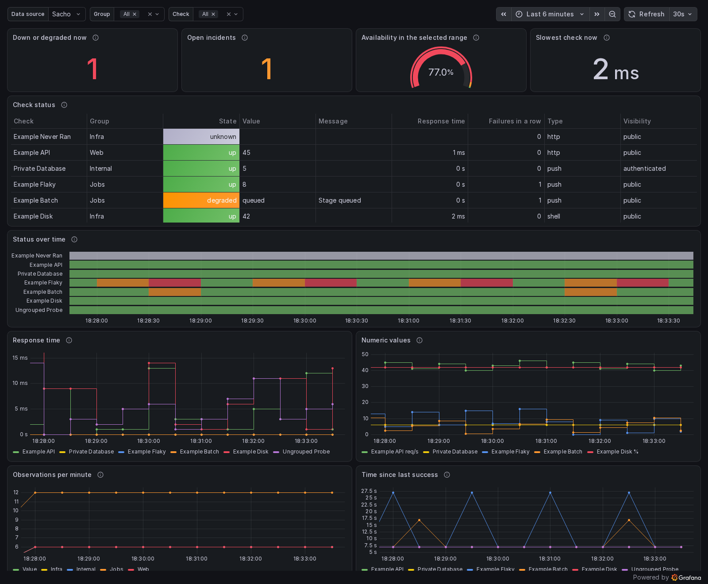

<!-- Copyright Jioh L. Jung <jung@jioh.net> -->
# Prometheus 지표와 Grafana

[English](METRICS.md) · 오프라인에서는 `sacho help metrics --language ko`

사초는 Grafana에 두 가지 길로 값을 줄 수 있고, 어느 길이든 같은 숫자가 나옵니다.

1. **직접 연결.** Grafana의 일반 Prometheus 데이터 원천을 사초 주소로 지정합니다.
   Prometheus 서버가 필요 없습니다. 사초가 저장한 점검 이력에서 답하며, `retention_days`로
   보관하는 기간만큼 볼 수 있습니다.
2. **Prometheus 경유.** Prometheus가 `GET /metrics`를 긁게 합니다(Prometheus 텍스트 형식과
   OpenMetrics 모두 지원). 데이터는 Prometheus에서 원하는 만큼 보관합니다.

두 길 모두 기본으로 켜져 있고, 상태 페이지처럼 공개 항목은 누구나 볼 수 있습니다.

## 빠른 시작

Grafana 직접 연결(`examples/grafana/provisioning/datasources/sacho.yaml`):

```yaml
apiVersion: 1
datasources:
  - name: Sacho
    uid: sacho
    type: prometheus
    access: proxy
    url: https://status.example.com
    jsonData:
      httpMethod: POST
      prometheusType: Prometheus
      prometheusVersion: 3.0.0
      timeInterval: 30s
```

`examples/grafana/dashboards/sacho-overview.json`을 가져오거나
`examples/grafana/provisioning/dashboards/sacho.yaml`로 자동 등록합니다. 대시보드 위쪽에서
데이터 원천을 고를 수 있어 같은 파일을 사초 직접 연결과 진짜 Prometheus 양쪽에 쓸 수 있습니다.

Prometheus로 긁기(`examples/grafana/prometheus.yml`):

```yaml
scrape_configs:
  - job_name: sacho
    scheme: https
    scrape_interval: 30s
    static_configs:
      - targets: [status.example.com]
```



## 내보내는 값

모든 점검 지표에는 `id`, `name`, `check_type`, `visibility` 라벨이 있고, 설정한 경우 `group`도 붙습니다.

| 지표 | 뜻 |
|---|---|
| `sacho_check_status` | 공개 상태: `0` 정상, `1` 성능 저하, `2` 장애, `3` 알 수 없음(최근 관측 없음) |
| `sacho_check_up` | 정상이면 `1`, 아니면 `0` |
| `sacho_check_latency_seconds` | 마지막 관측의 응답 시간 |
| `sacho_check_last_run_timestamp_seconds` | 마지막 관측 시각(Unix 시간) |
| `sacho_check_last_success_timestamp_seconds` | 마지막 성공 시각(Unix 시간) |
| `sacho_check_consecutive_failures` | 연속 실패 횟수 |
| `sacho_check_interval_seconds` | 설정된 점검 간격(초) |
| `sacho_check_incident_open` | 자동 감지된 사건이 열려 있으면 `1` |
| `sacho_check_value` | 점검이 공개하는 마지막 숫자. 설정한 경우 `unit` 라벨이 붙습니다. *추세 공개*를 켜거나, *값 공개*를 켜고 값이 숫자여야 합니다 |
| `sacho_check_runs_total` | 지금까지의 관측 수(누적) |
| `sacho_check_failed_runs_total` | 정상이 아니었던 관측 수(누적) |
| `sacho_check_info` | 값은 항상 `1`. 글자를 라벨로: `display_value`, `message`, `display_label`, `unit` |
| `sacho_check_state_info` | 값은 항상 `1`. 상태를 `state` 라벨로: `operational`, `degraded`, `outage`, `unknown` |
| `sacho_build_info` | 값은 항상 `1`. `version`, `target` 라벨 |
| `sacho_metrics_dropped_items` | `max_items` 때문에 빠진 항목 수 |

누적 값은 오래된 이력을 지워도 줄어들지 않습니다. 꺼 둔 점검은 내보내지 않습니다.

### 글자 값

시계열은 숫자만 담으므로, 글자는 Prometheus 관례대로 값이 항상 1인 "info" 지표의 라벨로
내보냅니다. Grafana에서는 라벨을 표로 보여 주거나 숫자에 붙입니다.

```promql
sacho_check_value * on(id) group_left(display_value) sacho_check_info
sacho_check_state_info{state="outage"}
```

숫자 대신 상태 낱말을 보이려면 예시 대시보드처럼 값 매핑(0 → up, 1 → degraded, 2 → down,
3 → unknown)을 넣습니다. `display_value`는 *값 공개*를 켠 점검에만, `message`는 공개 메시지
위치를 지정한 점검에만 있습니다. 항목의 접근 권한은 상태 페이지와 같지만, 점검 종류(`check_type`)·공개 범위(`visibility`)·연속 및 누적 실패 횟수도 표시합니다. 점검의 원본 출력은
내보내지 않습니다.

라벨이 바뀌면 새 시계열이 되므로, Prometheus로 긁는다면 시각처럼 매번 바뀌는 글자를
공개하지 않는 편이 좋습니다.

## 누가 무엇을 읽나

`/metrics`와 질의 API는 매 요청마다 상태 페이지와 같은 규칙을 따릅니다.

| 읽는 쪽 | 공개 항목 | 로그인 항목 | 그룹 항목 |
|---|---|---|---|
| 신원 없음 | 예 | 아니요 | 아니요 |
| 로그인 프록시를 거친 사용자 | 예 | 예 | 소속 그룹만 |
| 로그인 프록시를 거친 관리자 | 예 | 예 | 예 |
| 지표 토큰, `token_scope = "all"` | 예 | 예 | 예 |
| 지표 토큰, `token_scope = "authenticated"` | 예 | 예 | 아니요 |

권한 밖 항목은 질의 결과, 라벨 값, 시계열 목록 어디에도 나오지 않고 이름도 드러나지 않습니다.
기계가 읽으려면 토큰을 씁니다.

```toml
[metrics]
token_env = "SACHO_METRICS_TOKEN"     # 인쇄 가능한 글자 32~512자
token_scope = "authenticated"
```

값은 환경 변수나 암호화 입력에 두며, 점검 스크립트에는 전달할 수 없습니다.
`Authorization: Bearer <토큰>`으로 보냅니다. Prometheus에서는 `authorization:
credentials_file`을, Grafana에서는 자동 등록 예시처럼 사용자 지정 HTTP 헤더를 씁니다.
토큰이 틀리면 `401`입니다.

로그인 프록시 뒤에서는 Prometheus와 Grafana가 브라우저 로그인 없이 `/metrics`와 `/api/v1/`에
닿아야 합니다. `examples/deploy/proxy`의 설정은 나머지 경로를 신원 없이 통과시키므로 그대로
동작하며, 공개 항목과 토큰 소지자만 값을 봅니다. 모르는 경로를 로그인 화면으로 보내는 프록시라면
이 두 경로를 예외로 둡니다. 어느 경우든 프록시는 클라이언트가 보낸 신원 헤더를 지워야 합니다.

## 설정

```toml
[metrics]
enabled = true                 # false면 이 경로들이 모두 404
anonymous_enabled = true       # false면 토큰 또는 신뢰 프록시 인증 필요
token_env = "SACHO_METRICS_TOKEN"
token_scope = "authenticated"            # 그룹 항목도 읽으려면 "all"을 명시
max_items = 1000               # 내보낼 항목 수(id 순). 나머지는 개수만 셉니다
max_query_series = 10000       # 질의 하나가 돌려줄 시계열 수
max_query_samples = 2000000    # 저장 관측과 평가 중 생성하는 점 상한
max_query_bytes = 67108864    # 보관 데이터 예산(바이트), 기본 64 MiB
max_query_range_seconds = 2678400 # 질의 구간 상한(초), 기본 31일
query_timeout_seconds = 30
label_value_max_chars = 128    # 더 긴 라벨은 잘리고 "…"로 끝납니다
```

### `[metrics]`

| 설정 | 기본값 | 뜻 |
| --- | --- | --- |
| `enabled` | `true` | 모든 지표 경로 활성화. false면 404. |
| `anonymous_enabled` | `true` | 신원 없는 읽기 허용. false면 토큰 또는 신뢰 프록시 인증 필요. |
| `token_env` | `none` | 32~512자 토큰을 가진 환경 변수·암호화 입력의 이름. |
| `token_scope` | `authenticated` | 토큰 공개 범위. authenticated는 그룹 항목 제외, all은 명시해야 함. |
| `max_items` | `1000` | 공개할 항목 수, 1~100000. id 순이며 나머지는 개수만 표시. |
| `max_query_series` | `10000` | 질의당 시계열 수, 1~1000000. 바이트 예산도 적용. |
| `max_query_samples` | `2000000` | 저장 관측·파생 표본·생성 점 수, 1000~500000000. 바이트 예산도 적용. |
| `max_query_bytes` | `67108864` | 보관 데이터 예산(바이트), 1024~1073741824. 기본 64 MiB. |
| `max_query_range_seconds` | `2678400` | 조회 구간 상한(초), 1~31622400. 기본 31일. |
| `query_timeout_seconds` | `30` | SQL 및 평가 시간 제한(초), 1~600. |
| `label_value_max_chars` | `128` | 라벨 길이 상한(문자 수), 16~1024. |

숫자는 `sacho_check_value`로 내보내며 `display_value` 라벨에는 넣지 않습니다. 글자나 메시지가 바뀌면 새 시계열이 생깁니다.

*추세 공개*(`publish_trend`)를 끄면 숫자·글자·메시지는 저장소의 **가장 마지막 관측에만** 붙습니다. 과거 시각 질의, 범위 질의, 라벨 목록으로 예전 값을 복구할 수 없습니다. 토큰 소지자와 관리자에게도 같은 규칙이 적용됩니다. 과거 값을 그래프로 보려면 추세 공개를 명시적으로 켜세요. 값 공개(`publish_value`)와 공개 메시지 위치 설정도 계속 적용됩니다.

기본 동시 실행은 익명 질의 2개, 인증 질의 2개, `/metrics` 긁기 1개로 분리됩니다. 익명과 긁기 칸이 차면 즉시 `503`으로 답합니다. Grafana의 동시 패널 요청을 위해 인증 질의만 최대 32개가 1초까지 대기하며, 대기 칸 또는 시간이 초과되면 `503`입니다. 익명 질의에는 설정값과 다음 값 중 더 작은 상한을 적용합니다: 관측·생성 점 200,000개, 시계열 2,000개, 보관 데이터 예산 16 MiB, 조회 구간 7일, 실행 시간 5초. 긁기에는 일반 설정 상한을 적용합니다.

`max_query_samples`는 저장 관측, 파생 표본과 부분 질의가 생성하는 점을 제한합니다. 결과는 시계열당 최대 11,000점입니다. `max_query_bytes`는 보관하는 관측과 시계열의 바이트 예산이며, 프로세스 전체 메모리의 정확한 상한은 아닙니다. 평가기의 점 상한도 바이트 예산/128, 시계열 상한도 바이트 예산/512 이하로 낮춥니다. 문자열·배열·JSON 응답을 만드는 임시 공간은 추가로 필요합니다. 원본 출력은 행마다 메시지만 뽑고 버리며, 64 KiB가 넘는 원본 출력의 메시지는 생략합니다. SQLite 계산도 시간 제한에 도달하면 중단합니다. 상한을 넘으면 부분 결과를 보내지 않고 오류로 끝냅니다.

긴 구간은 관측을 많이 읽습니다. 1분 간격 점검을 30일 보면 항목당 약 43,000개의 관측입니다. 필요하면 인증 토큰을 사용하거나 Prometheus로 긁어 별도로 보관하세요. 토큰은 첫 요청에서 한 번 읽어 해시만 보관하므로 변경 후 서버를 재시작해야 합니다.

## Prometheus API

Grafana가 쓰는 다음 경로가 Prometheus 형식과 오류 형식으로 답합니다.
`/api/v1/query`, `/api/v1/query_range`, `/api/v1/series`, `/api/v1/labels`,
`/api/v1/label/<이름>/values`, `/api/v1/metadata`, `/api/v1/status/buildinfo`. 앞의 네 개는
POST 폼도 받습니다. `/api/v1/rules`, `/api/v1/alerts`, `/api/v1/query_exemplars`는 빈 목록을
돌려줍니다. Grafana 변수의 `label_values(...)`, `metrics(...)`는 동작하지만 "질의 정리(format
query)" 버튼은 동작하지 않습니다.

### 지원하는 PromQL

- **선택:** 지표 이름, `{__name__=~"..."}`, `=`, `!=`, `=~`, `!~`, 구간 `[5m]`, 부분 질의
  `[5m:1m]`, `offset`, `@`(시각, `start()`, `end()`).
- **연산:** `+ - * / % ^ atan2`, `== != > < >= <=`(`bool` 포함), `and or unless`, `on`,
  `ignoring`, `group_left`, `group_right`.
- **집계:** `sum avg min max count group stddev stdvar topk bottomk count_values quantile`,
  `by`와 `without` 포함.
- **시간 구간 함수:** `rate irate increase delta idelta deriv predict_linear changes resets
  avg_over_time min_over_time max_over_time sum_over_time count_over_time last_over_time
  present_over_time stddev_over_time stdvar_over_time quantile_over_time absent_over_time`.
- **그 밖의 함수:** `abs ceil floor round sqrt exp ln log2 log10 sgn clamp clamp_min clamp_max
  sort sort_desc timestamp absent time pi vector scalar label_replace label_join year month
  day_of_month day_of_week day_of_year days_in_month hour minute`.

그 밖의 질의(`histogram_quantile`, 네이티브 히스토그램, `info()`, `limitk`, 실험 함수 등)는
HTTP 400과 `"errorType":"bad_data"`로 거절합니다. 사초에는 히스토그램이 없고, 질의를 몰래
다르게 해석하는 일은 없습니다.

### 진짜 Prometheus와 다른 점

사초는 긁은 값이 아니라 관측을 저장합니다. 값은 다음 관측까지 유지된 것으로 봅니다.
`/metrics`가 계속 같은 값을 보여 주는 것과 같습니다. 호환성 시험
(`tests/metrics_compat_docker.py`)은 진짜 Prometheus를 진짜 사초에 붙이고, 같은 질의를 같은
시각에 양쪽에 던져 순간 질의와 구간 질의를 모두 비교합니다.

<!-- compat -->
최근 실행(Prometheus 3.15.1, Grafana 13.2.3, 1초마다 긁기, 10초마다 관측, 이력 7분)에서 비교 114건은
**정확히 일치 99건**, **근접 10건**, **구조적으로 다름 5건**이었습니다. "정확히 일치"(exact)는 라벨, 시각,
값이 모두 같다는 뜻이고, "근접"(close)은 라벨과 시각이 같고 값 차이가 15% 이내라는 뜻입니다. 아래 표는 정확히 일치하지
않은 질의 전부와 관측된 가장 큰 차이입니다. 일치한 것에는 모든 선택자와 라벨 일치, 집계, 산술과 비교, `group_left` 결합,
`label_replace`, `label_join`, `offset`, `@`, 부분 질의, `max_over_time`, `min_over_time`, `last_over_time`, `changes`, `resets`, `absent`,
Grafana 변수가 쓰는 라벨·시계열 목록이 들어 있습니다.

| 질의 | 결과 | 가장 큰 차이 | 이유 |
|---|---|---|---|
| `avg_over_time(sacho_check_up[5m])` | close | 0.7% | 사초는 유지 시간으로 가중, Prometheus는 긁은 값의 평균 |
| `avg_over_time(sacho_check_value[1m])` | close | 3.6% | 사초는 유지 시간으로 가중, Prometheus는 긁은 값의 평균 |
| `delta(sacho_check_runs_total[1m])` | close | 1.7% | Prometheus는 구간 끝까지 늘려 추정, 사초는 실제 변화량 |
| `deriv(sacho_check_runs_total[5m])` | close | 0.5% | 사초는 관측, Prometheus는 긁은 값에 맞춘 직선 |
| `increase(sacho_check_runs_total[1m])` | close | 1.7% | Prometheus는 구간 끝까지 늘려 추정, 사초는 실제 횟수 |
| `quantile_over_time(0.5, sacho_check_value[5m])` | close | 9.1% | 사초는 관측, Prometheus는 긁은 값으로 계산 |
| `rate(sacho_check_runs_total[1m] offset 1m)` | close | 1.7% | Prometheus는 구간 끝까지 늘려 추정, 사초는 실제 횟수 |
| `rate(sacho_check_runs_total[1m])` | close | 1.7% | Prometheus는 구간 끝까지 늘려 추정, 사초는 실제 횟수 |
| `stddev_over_time(sacho_check_value[5m])` | close | 2.0% | 사초는 관측, Prometheus는 긁은 값으로 계산 |
| `sum by (group) (rate(sacho_check_runs_total[5m]))` | close | 0.3% | Prometheus는 구간 끝까지 늘려 추정, 사초는 실제 횟수 |
| `count_over_time(sacho_check_value[1m])` | different | — | Prometheus는 긁은 횟수, 사초는 관측 횟수 |
| `idelta(sacho_check_status[1m])` | different | — | 마지막 두 표본의 간격이 Prometheus는 1초, 사초는 점검 주기 하나 |
| `irate(sacho_check_runs_total[1m])` | different | — | 마지막 두 표본의 간격이 Prometheus는 1초, 사초는 점검 주기 하나 |
| `sum_over_time(sacho_check_value[1m])` | different | — | Prometheus는 긁을 때마다, 사초는 관측마다 더함 |
| `timestamp(sacho_check_status)` | different | — | Prometheus는 긁은 시각, 사초는 관측 시각 |

비교 시각은 관측에서 먼 때로 고릅니다. 관측 직후에는 두 시스템이 긁기 한 번만큼 다를 수 있기 때문입니다(아래 참고).
<!-- /compat -->

기억할 점:

- **추정이 아니라 실제 횟수.** `rate`, `increase`는 구간 안에서 실제로 일어난 일을 셉니다.
  Prometheus는 구간 안의 처음과 마지막 긁기로 구간 끝까지 늘려 추정하므로 조금 다르고, 구간이
  긁기 간격보다 길수록 차이가 줄어듭니다. 구간에 긁기가 두 번 미만이면 Prometheus는 답이 없지만
  사초는 값을 줍니다.
- **시간 가중 평균.** `avg_over_time`은 각 값을 유지된 시간만큼 가중합니다. 일정한 간격의 긁기가
  근사하는 값입니다. 실제 시간 비율이므로 `avg_over_time(sacho_check_up[30d])`로 구한 가용률이
  긁기 간격에 좌우되지 않습니다.
- **관측 단위 구간 함수.** `count_over_time`, `sum_over_time`은 사초에서는 관측을, Prometheus에서는
  긁기를 셉니다. `irate`, `idelta`는 마지막 두 관측과 마지막 두 긁기를 각각 비교합니다.
  `timestamp()`는 관측 시각과 긁은 시각을 각각 줍니다.
- **5분 제한 없음.** 값은 다음 관측까지, 또는 점검이 "알 수 없음"이 될 때까지 유지되고 되돌아보기
  상한이 없습니다. 하루 한 번 도는 점검도 끊기지 않습니다.
- **시점.** 긁기는 관측을 다음 긁기에서야 봅니다. 사초는 관측 시각을 초 단위로 알기 때문에, 값이
  바뀌는 순간 주변에서는 최대 긁기 간격 하나만큼 다를 수 있습니다.
- **점검을 고치면.** 시계열은 과거 시점에도 점검의 현재 이름·그룹·설정을 보여 줍니다. Prometheus는
  긁었을 때의 라벨을 그대로 둡니다.

## 시험

```sh
cargo test --test metrics
cargo build --release --target x86_64-unknown-linux-musl
SACHO_BINARY=target/x86_64-unknown-linux-musl/release/sacho python3 tests/metrics_compat_docker.py
```

두 번째 시험에는 Docker와 Playwright가 필요하고 약 10분 걸립니다. 사초, Prometheus, Grafana를
전용 Docker 네트워크에서 띄웠다가 지웁니다. 모든 질의의 표와 화면 사진은 `runtime/metrics-compat/`에
남습니다.

Prometheus는 현재 값을 반복해서 긁어 자체 이력을 보관하므로, 사초의 추세 공개를 꺼도 Prometheus가 이미 수집한 값은 그 서버에 남습니다. 사초 직접 질의는 그 과거 값을 되살리지 않습니다. 호환성 시험의 역사 비교 대상은 추세 공개를 명시적으로 켭니다.

`label_join`·`label_replace`가 계산해 만든 라벨도 바이트 예산을 쓰며, 값은 4,096바이트·라벨 이름은 128바이트로 제한합니다. 중첩 계산으로 문자열이 무한히 커지면 오류로 중단합니다.
