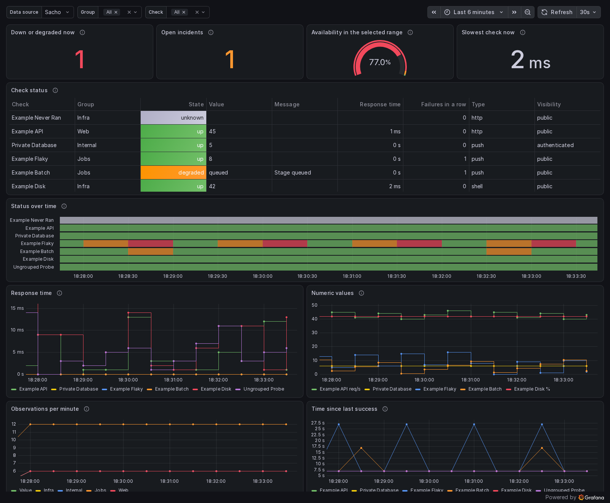

<!-- Copyright Jioh L. Jung <jung@jioh.net> -->
# Prometheus metrics and Grafana

[한국어](METRICS.ko.md) · also available offline as `sacho help metrics`

Sacho can feed Grafana in two ways, and both show the same numbers:

1. **Directly.** Point Grafana's ordinary Prometheus data source at Sacho. No Prometheus
   server is needed. Sacho answers from its stored check history, for as long as
   `retention_days` keeps it.
2. **Through Prometheus.** Let Prometheus scrape `GET /metrics`, in either the Prometheus
   text format or OpenMetrics, and keep the data as long as you like.

Both are on by default and show public checks to anyone, like the status page itself.

## Quick start

Direct Grafana data source (`examples/grafana/provisioning/datasources/sacho.yaml`):

```yaml
apiVersion: 1
datasources:
  - name: Sacho
    uid: sacho
    type: prometheus
    access: proxy
    url: https://status.example.com
    jsonData:
      httpMethod: POST
      prometheusType: Prometheus
      prometheusVersion: 3.0.0
      timeInterval: 30s
```

Import `examples/grafana/dashboards/sacho-overview.json`, or provision it with
`examples/grafana/provisioning/dashboards/sacho.yaml`. The dashboard has a data source
selector, so the same file works with Sacho directly and with a real Prometheus.

Scraping with Prometheus (`examples/grafana/prometheus.yml`):

```yaml
scrape_configs:
  - job_name: sacho
    scheme: https
    scrape_interval: 30s
    static_configs:
      - targets: [status.example.com]
```



## What is exposed

Every check series has the labels `id`, `name`, `check_type`, `visibility` and, when set,
`group`.

| Metric | Meaning |
|---|---|
| `sacho_check_status` | Published state: `0` up, `1` degraded, `2` down, `3` unknown (no recent observation) |
| `sacho_check_up` | `1` while up, otherwise `0` |
| `sacho_check_latency_seconds` | Response time of the latest observation |
| `sacho_check_last_run_timestamp_seconds` | Unix time of the latest observation |
| `sacho_check_last_success_timestamp_seconds` | Unix time of the latest successful observation |
| `sacho_check_consecutive_failures` | Failed observations in a row |
| `sacho_check_interval_seconds` | Configured seconds between checks |
| `sacho_check_incident_open` | `1` while an automatically detected incident is open |
| `sacho_check_value` | Latest number the check publishes, with a `unit` label when set. Needs *publish trend*, or *publish value* with a numeric value |
| `sacho_check_runs_total` | Observations so far (counter) |
| `sacho_check_failed_runs_total` | Observations that were not up (counter) |
| `sacho_check_info` | Always `1`. Text as labels: `display_value`, `message`, `display_label`, `unit` |
| `sacho_check_state_info` | Always `1`. The state as a `state` label: `operational`, `degraded`, `outage`, `unknown` |
| `sacho_build_info` | Always `1`. Labels `version` and `target` |
| `sacho_metrics_dropped_items` | Visible checks left out by `max_items` |

The counters survive removal of old history. Checks that are switched off are not exposed.

### Text values

A time series holds numbers, so text is exposed the way Prometheus exporters do it: as
labels on an "info" metric whose value is always 1. In Grafana, either show the labels
in a table or join them onto a number:

```promql
sacho_check_value * on(id) group_left(display_value) sacho_check_info
sacho_check_state_info{state="outage"}
```

For a state word instead of a number, add value mappings (0 → up, 1 → degraded, 2 → down,
3 → unknown) as the example dashboard does. `display_value` only exists for checks with
*publish value* on and `message` only for checks with a public message pointer. These publication switches also apply to tokens. Raw check output is never exposed.

A changed text value starts a new series, since labels identify a series. Avoid publishing
text that changes on every run, such as a timestamp, if you scrape with Prometheus.

## Who can read what

`/metrics` and the query API use the rules of the status page, on every request:

| Reader | Public checks | Signed-in checks | Group checks |
|---|---|---|---|
| Nobody identified | yes | no | no |
| Signed in through the login proxy | yes | yes | member groups only |
| Administrator through the login proxy | yes | yes | yes |
| Metrics token, `token_scope = "all"` | yes | yes | yes |
| Metrics token, `token_scope = "authenticated"` | yes | yes | no |

Restricted checks do not appear in query results, label values or series lists, and their
names are not revealed. A token is the way for machines to read them:

```toml
[metrics]
token_env = "SACHO_METRICS_TOKEN"     # 32 to 512 printable characters
token_scope = "authenticated"
```

Keep the value in the environment or the encrypted inputs. It can't be passed to checks.
Send it as `Authorization: Bearer <token>`. In Prometheus use `authorization:
credentials_file`, and in Grafana a custom HTTP header as in the provisioning example.
A wrong token gets `401`.

Behind a login proxy, scrapers and Grafana must reach `/metrics` and `/api/v1/` without a
browser login. The catch-all location of the configurations in `examples/deploy/proxy` already
serves them without an identity, so only public checks and token holders see anything. If
yours redirects unknown paths to a sign-in page, add an exception for these two paths. As
always, the proxy must strip any identity header sent by the client.

## Settings

```toml
[metrics]
enabled = true                 # false: all of these endpoints answer 404
anonymous_enabled = true       # false: require token or trusted proxy identity
token_env = "SACHO_METRICS_TOKEN"
token_scope = "authenticated"            # set "all" explicitly to include group-restricted checks
max_items = 1000               # checks exposed, in order of id; the rest are counted
max_query_series = 10000       # series one query may return
max_query_samples = 2000000    # stored observations and generated evaluation points
max_query_bytes = 67108864    # retained-data budget in bytes (64 MiB)
max_query_range_seconds = 2678400 # maximum history range in seconds (31 days)
query_timeout_seconds = 30
label_value_max_chars = 128    # longer labels are cut and end in "…"
```

### `[metrics]`

| Setting | Default | Meaning |
| --- | --- | --- |
| `enabled` | `true` | Enable all metrics endpoints; false returns 404. |
| `anonymous_enabled` | `true` | Allow anonymous reads; false requires a token or trusted proxy identity. |
| `token_env` | `none` | Environment variable or vault input name containing a 32–512 byte token. |
| `token_scope` | `authenticated` | Token scope: authenticated excludes group-restricted items; all requires explicit opt-in. |
| `max_items` | `1000` | Exposed item count, 1–100000; ordered by ID, omitted items counted. |
| `max_query_series` | `10000` | Series per query, 1–1000000; also constrained by the byte budget. |
| `max_query_samples` | `2000000` | Stored observations, derived samples and generated points, 1000–500000000; also byte-budget limited. |
| `max_query_bytes` | `67108864` | Retained-data budget in bytes, 1024–1073741824; default 64 MiB. |
| `max_query_range_seconds` | `2678400` | Maximum history range in seconds, 1–31622400; default 31 days. |
| `query_timeout_seconds` | `30` | SQL and evaluation deadline in seconds, 1–600. |
| `label_value_max_chars` | `128` | Maximum label length in characters, 16–1024. |

Numeric values appear in `sacho_check_value`, not in the `display_value` label. Changing text or messages creates new series.

When `publish_trend` is false, numbers, text and messages are projected by SQL only for the **latest stored observation**. Past-time queries, range queries and label listings cannot recover older values. This rule also applies to tokens and administrators. Enable trend publication explicitly to graph historical values. `publish_value` and the public message pointer still control their respective fields. Besides the status page fields, metrics expose check type, visibility, consecutive failures and cumulative failure counts.

Concurrency slots are separate: two anonymous queries, two authenticated queries and one `/metrics` scrape. Full anonymous and scrape pools immediately return `503`. Authenticated queries alone may wait up to one second in a queue of at most 32 requests, allowing Grafana panel bursts without increasing active work; overflow or timeout returns `503`. Anonymous queries use the smaller of the configured limits and: 200,000 observations/generated points, 2,000 series, a 16 MiB retained-data budget, seven days of history and five seconds of execution. Scrapes use the normal configured limits.

`max_query_samples` covers stored observations, derived samples and generated subquery points. Results have at most 11,000 points per series. `max_query_bytes` budgets retained timeline and series data, not exact total process RSS. Evaluation points are also capped at bytes/128 and series at bytes/512. Temporary strings, vectors and JSON response construction require additional space. Raw outputs are processed one row at a time and discarded; messages from outputs exceeding 64 KiB are omitted. SQLite computation is interrupted at the deadline too. Limits return errors instead of partial results.

A thirty-day range of one-minute checks has about 43,000 observations per check. Use an authenticated token or scrape into Prometheus for longer dashboards. The token is read once on the first request and only its digest is cached; restart the server after rotation.

## Prometheus API

Grafana uses these endpoints, which answer in Prometheus' format and error format:
`/api/v1/query`, `/api/v1/query_range`, `/api/v1/series`, `/api/v1/labels`,
`/api/v1/label/<name>/values`, `/api/v1/metadata`, `/api/v1/status/buildinfo`. The first
four also accept POST forms. `/api/v1/rules`, `/api/v1/alerts` and
`/api/v1/query_exemplars` answer with empty lists. Grafana's variable helpers
`label_values(...)` and `metrics(...)` work; its "format query" button does not.

### Supported PromQL

- **Selectors:** metric names, `{__name__=~"..."}`, `=`, `!=`, `=~`, `!~`, range `[5m]`,
  subquery `[5m:1m]`, `offset`, `@` with a time, `start()` or `end()`.
- **Operators:** `+ - * / % ^ atan2`, `== != > < >= <=` with `bool`, `and or unless`,
  `on`, `ignoring`, `group_left`, `group_right`.
- **Aggregation:** `sum avg min max count group stddev stdvar topk bottomk count_values
  quantile`, with `by` or `without`.
- **Time windows:** `rate irate increase delta idelta deriv predict_linear changes resets
  avg_over_time min_over_time max_over_time sum_over_time count_over_time last_over_time
  present_over_time stddev_over_time stdvar_over_time quantile_over_time
  absent_over_time`.
- **Other functions:** `abs ceil floor round sqrt exp ln log2 log10 sgn clamp clamp_min
  clamp_max sort sort_desc timestamp absent time pi vector scalar label_replace label_join
  year month day_of_month day_of_week day_of_year days_in_month hour minute`.

Anything else, for example `histogram_quantile`, native histograms, `info()`, `limitk` or
the experimental functions, is refused with HTTP 400 and `"errorType":"bad_data"`. There are
no histograms in Sacho, and no query is ever quietly reinterpreted.

### How the answers differ from a Prometheus

Sacho stores observations, not scrapes. A value counts as held until the next observation,
just as `/metrics` keeps showing it. The compatibility test
(`tests/metrics_compat_docker.py`) runs a real Prometheus against a real Sacho and compares
the same queries through both, on the same moments, over instant and range queries.

<!-- compat -->
In the latest run (Prometheus 3.15.1, Grafana 13.2.3, one scrape per second, one observation
every 10 seconds, 7 minutes of history), 114 comparisons gave **99 exact**, **10
close** and **5 different by design**. "Exact" means the same labels, times and values.
"Close" means the same labels and times, and values within 15%. The table lists every query that was not exact,
with the largest difference seen. The exact ones include all selectors and label matching, aggregation,
arithmetic and comparison, `group_left` joins, `label_replace`, `label_join`, `offset`, `@`, subqueries,
`max_over_time`, `min_over_time`, `last_over_time`, `changes`, `resets`, `absent`, and the label and series
lists Grafana uses for variables.

| Query | Result | Largest difference | Why |
|---|---|---|---|
| `avg_over_time(sacho_check_up[5m])` | close | 0.7% | Sacho weighs by time held; Prometheus averages the scrapes |
| `avg_over_time(sacho_check_value[1m])` | close | 3.6% | Sacho weighs by time held; Prometheus averages the scrapes |
| `delta(sacho_check_runs_total[1m])` | close | 1.7% | Prometheus extrapolates to the window edges; Sacho knows the exact change |
| `deriv(sacho_check_runs_total[5m])` | close | 0.5% | Fitted to observations here and to scrapes in Prometheus |
| `increase(sacho_check_runs_total[1m])` | close | 1.7% | Prometheus extrapolates to the window edges; Sacho knows the exact count |
| `quantile_over_time(0.5, sacho_check_value[5m])` | close | 9.1% | Sacho uses observations; Prometheus uses scrapes |
| `rate(sacho_check_runs_total[1m] offset 1m)` | close | 1.7% | Prometheus extrapolates to the window edges; Sacho knows the exact count |
| `rate(sacho_check_runs_total[1m])` | close | 1.7% | Prometheus extrapolates to the window edges; Sacho knows the exact count |
| `stddev_over_time(sacho_check_value[5m])` | close | 2.0% | Sacho uses observations; Prometheus uses scrapes |
| `sum by (group) (rate(sacho_check_runs_total[5m]))` | close | 0.3% | Prometheus extrapolates to the window edges; Sacho knows the exact count |
| `count_over_time(sacho_check_value[1m])` | different | — | Prometheus counts scrapes; Sacho counts observations |
| `idelta(sacho_check_status[1m])` | different | — | Uses the last two samples: 1 s apart in Prometheus, one check period apart in Sacho |
| `irate(sacho_check_runs_total[1m])` | different | — | Uses the last two samples: 1 s apart in Prometheus, one check period apart in Sacho |
| `sum_over_time(sacho_check_value[1m])` | different | — | Prometheus adds one value per scrape; Sacho one per observation |
| `timestamp(sacho_check_status)` | different | — | Prometheus gives the scrape time; Sacho gives the observation time |

The comparison picks moments far from any observation, because close to one the two systems
can legitimately differ by a scrape (see below).
<!-- /compat -->

Things to keep in mind:

- **Exact counts, not estimates.** `rate` and `increase` count what happened in the window.
  Prometheus estimates by extrapolating from its first and last scrape in the window, so it
  differs slightly, and the difference shrinks as the window grows relative to the scrape
  interval. A `rate` over a window with fewer than two scrapes returns nothing in Prometheus,
  but a value here.
- **Time-weighted averages.** `avg_over_time` weighs each value by how long it was held, which
  is what evenly spaced scrapes approximate. It is the true share of time, so availability
  from `avg_over_time(sacho_check_up[30d])` does not depend on a scrape interval.
- **Per-observation windows.** `count_over_time` and `sum_over_time` count observations here
  and scrapes in Prometheus. `irate` and `idelta` compare the last two observations here and
  the last two scrapes there. `timestamp()` gives the observation time here and the scrape
  time there.
- **No five-minute limit.** A series holds its value until the next observation or until the
  check turns unknown, with no lookback limit, so a check that runs daily has no gaps.
- **Moments.** A scrape sees an observation only at the next scrape. Sacho knows the moment
  the observation happened, to the second, so around a change, the two can differ for up to
  one scrape interval.
- **Changing a check.** Series reflect a check's current name, group and settings, also for
  past times. Prometheus keeps the labels as they were when scraped.

## Testing

```sh
cargo test --test metrics
cargo build --release --target x86_64-unknown-linux-musl
SACHO_BINARY=target/x86_64-unknown-linux-musl/release/sacho python3 tests/metrics_compat_docker.py
```

The second test needs Docker and Playwright and takes about ten minutes. It starts Sacho,
Prometheus and Grafana on a private Docker network and removes them afterwards. It writes a
table of every query and screenshots to `runtime/metrics-compat/`.

Prometheus retains its own history of scraped current values even when Sacho trend publication is disabled. Direct Sacho queries do not reconstruct those past values. Historical compatibility fixtures explicitly enable trend publication.

Computed `label_join`/`label_replace` labels also consume a byte budget. Values are limited to 4,096 bytes and label names to 128 bytes; nested string expansion stops with an error.
